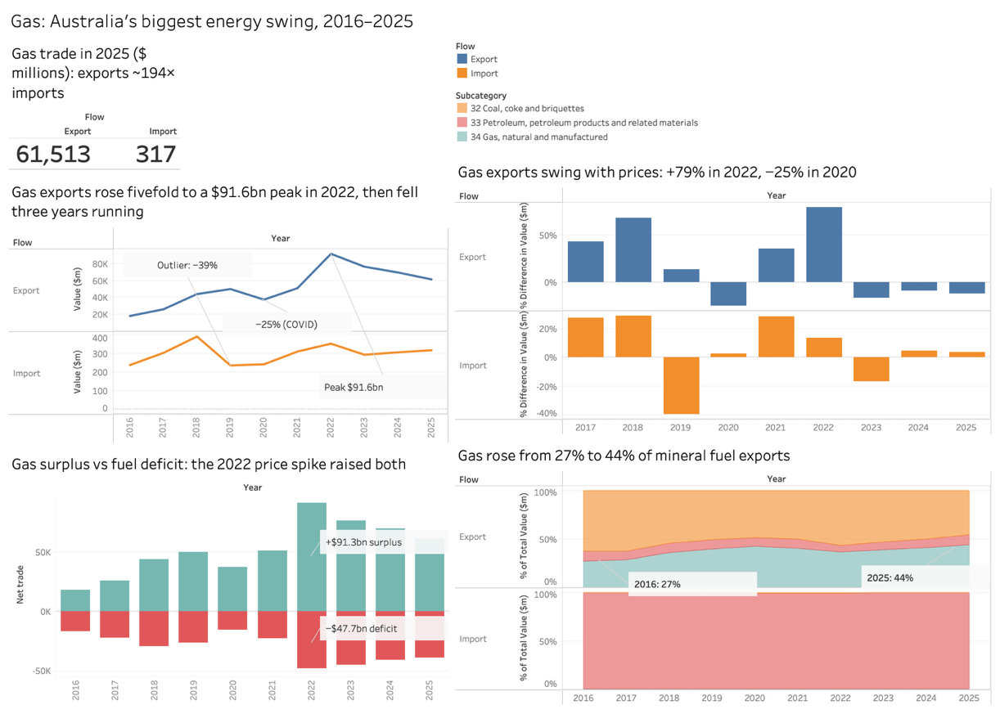
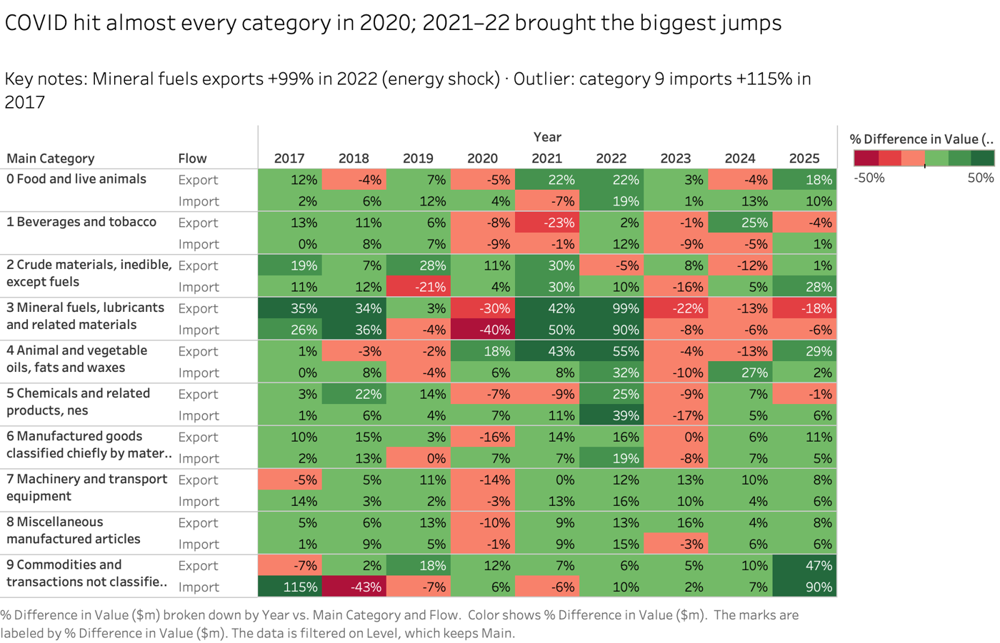
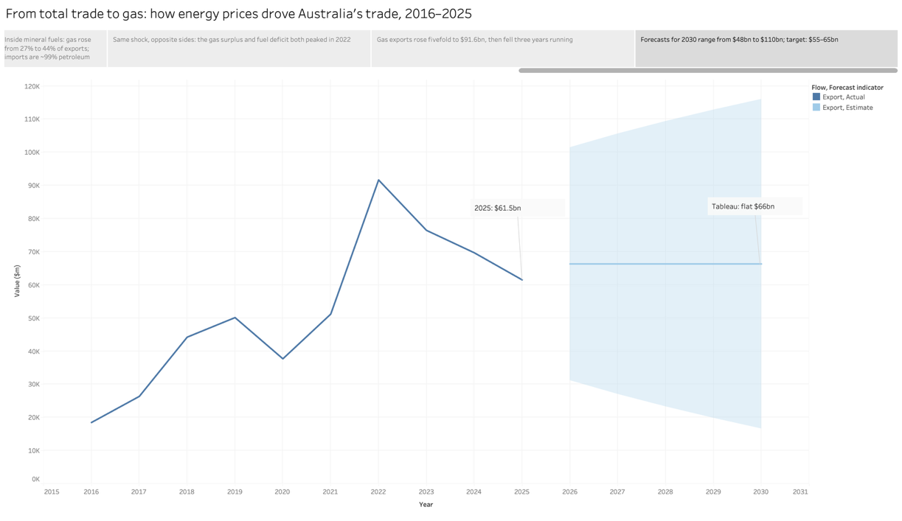

# Australian International Trade 2016–2025: How Energy Prices Shaped Trade

**Tools:** Excel (statistical analysis), Tableau (dashboard, storyboard, forecasting)
**Data:** Australian Bureau of Statistics, International Trade dataset, calendar years 2016–2025, A$ millions. 10 main SITC categories and 67 subcategories, imports and exports.
**Audience:** public policy and government decision makers

## The question

How did energy prices shape Australia's international trade over the past decade? Within that, what happened to natural gas exports (SITC 34), and what is a realistic target for 2030?

## Key findings

1. **Most categories moved together.** They shared the same change points: a COVID-19 fall in 2020, a commodity and energy price boom in 2021–22, and a retreat in 2023–24 as prices eased. Exports doubled from $258.5bn in 2016 to a peak of $593.9bn in 2022.
2. **Mineral fuels swung hardest, and gas grew within them.** Mineral fuel exports fell 30% in 2020 and rose 99% in 2022. Gas grew from 27% to 44% of fuel exports and has nearly caught up with coal.
3. **One price shock hit both sides of trade.** In 2022 the gas surplus reached $91.3bn just as the petroleum deficit reached $47.7bn, because Australia exports almost all the gas it trades but imports almost all its petroleum.
4. **Gas exports rose almost fivefold** to $91.6bn in 2022, then fell for three years to $61.5bn. They earned $527bn over the decade, a compound annual growth rate of 14.3%.

## Method

- **Excel first, so every number is traceable.** A long-format cleaned dataset, with separate sheets for export and import statistics, trade balance and fuel share. Measures include year-on-year change, mean and standard deviation, CAGR, an index (2016 = 100), share of total and net trade.
- **Rule-based change points.** A year is flagged when its year-on-year change falls outside the series' mean change plus or minus one standard deviation. For gas exports this flagged 2018, 2020 and 2022.
- **Tableau visuals chosen for the question each answers:** a heat map of year-on-year change across all categories, index lines, 100% area charts for fuel share, diverging bars for surplus and deficit, and KPI text on the dashboard.
- **Consistent design rules:** exports always blue, imports always orange, and every chart title states its finding.

## Forecast and recommendation

Gas export value depends mainly on world prices rather than volume. In 2020, volume hit a record while value fell 25%. So I compared three forecasting approaches for 2030:

| Method | 2030 forecast |
|---|---|
| Straight-line trend | about $110bn |
| Tableau exponential smoothing (model rated its own quality "Poor") | about $66bn, flat |
| ChatGPT, given the ten annual values | about $48bn |

The straight line treats the 2022 price spike as a new normal, while the AI forecast ignores new supply from Woodside's Scarborough project. **Recommendation:** a target of about $55–65bn a year by 2030, reviewed annually, with price and volume tracked separately and stronger fuel-import security.

## What I learned about AI-assisted analysis

ChatGPT described the trend quickly and accurately, but its forecast was judgement presented as precise numbers, with no reproducible method. AI output like this is useful as a second opinion, but it needs checking against a transparent model.
