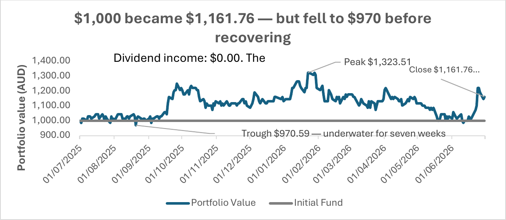

# BCI Minerals (ASX: BCI) — Stock Analysis, FY2025–26

**Tools:** Excel (verification, calculations, nine charts)
**Data:** daily price and volume history, 1 July 2025 – 30 June 2026 (254 ASX trading days), from DatAnalysis Premium (Morningstar)
**Audience:** prospective profit-seeking investors

> **About the data:** the underlying price data comes from a licensed commercial database, so it is not included in this repository. The analysis, charts and method are shared here.

## The question

How did BCI Minerals perform as an investment over FY2025–26, how did the market behave around company news, and who is this stock suited to?

## Key findings

- **Return:** +16.18% for the year. $1,000 invested finished at $1,161.76, but it fell to $970.59 first and spent seven weeks underwater. Annualised volatility was 38.4% and maximum drawdown −25.6%.
- **No income component.** BCI paid no dividend, so the whole return was capital gain.
- **Selling is more concentrated than buying.** Down days averaged 46% more volume than up days. Volume tracked the size of price moves (correlation 0.509 with intraday range) rather than their direction, and the heaviest volume clustered at turning points.
- **The market took two sessions to digest company news.** Both quarterly activity reports in the second half drew a modest rise on ordinary volume, then heavy selling two sessions later.
- **A simple valuation signal:** when price sat more than 8% below its 50-day moving average, the following 20 days returned +7.19% on average. This is descriptive, from a single year, and not a trading rule.

## Method

- **Verified the data before analysing it:** row count against trading days, no duplicate or weekend dates, Low ≤ Open/Close ≤ High checked on every row, no zero volumes, and market capitalisation reconciled against price × shares on issue.
- **Kept the raw export untouched.** All analysis sheets reference it by formula, so a correction flows through automatically.
- **Analysis:** 20- and 50-day moving averages, MA50 deviation oscillator, volatility and drawdown, capital change decomposition (88.9% of the market-cap increase came from price), close-price distribution, PE ratio against its mean, and a rebased price index.
- **Trade analysis:** the best single trade would have returned +36.36%. A constrained three-trade strategy would have returned $1,908.69 from $1,000 after brokerage.

## Recommendation

BCI suits a patient, risk-tolerant investor with a multi-year horizon and no need for income. Entries are best taken on capitulation volume rather than on momentum.
