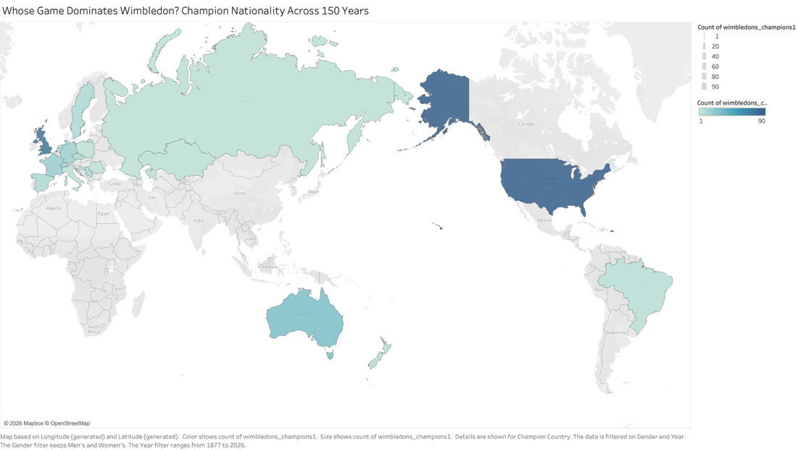
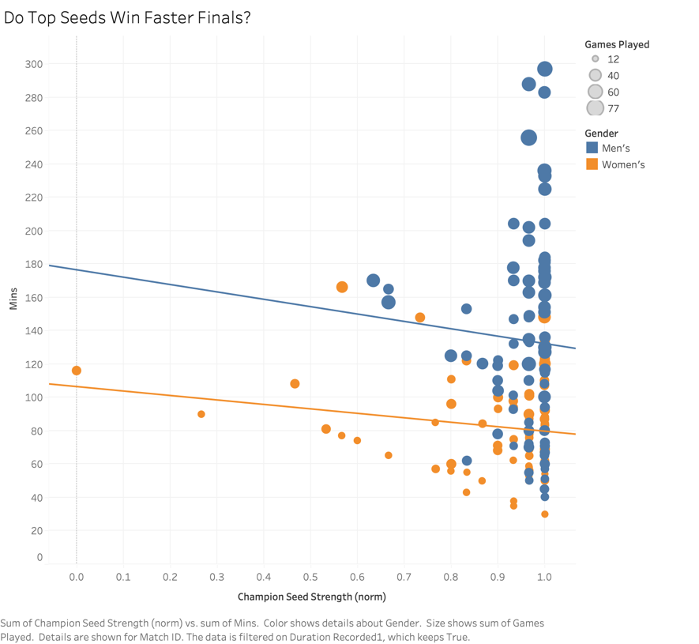
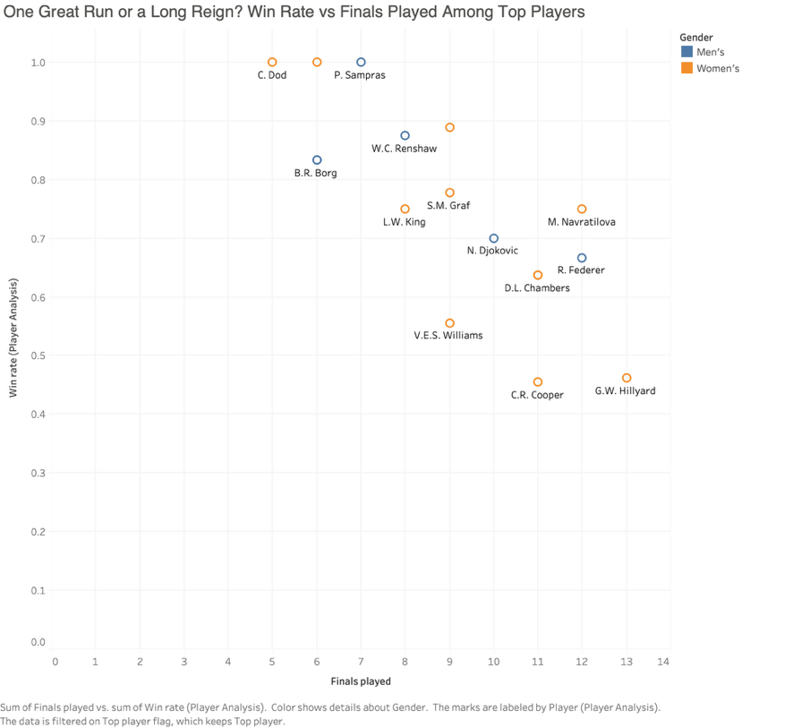

# Wimbledon Through the Years: 150 Years of Singles Finals

**Tools:** Excel (cleaning, derived fields, player-level table), Tableau (nine visuals)
**Data:** all 271 Gentlemen's and Ladies' singles finals, 1877–2026
**Audience:** people who follow tennis, not data specialists

## The question

What are the key changes across roughly 150 years of Wimbledon finals?

## Key findings

1. **Wimbledon has gone global.** Every champion for the first 23 years was British. Until 1989 the UK, US and Australia took more than four in five titles. Since 1990, champions have come from seven to nine nations each decade, and those three nations' share has halved to 42%.
2. **Finals have doubled in length because each game takes longer.** A gentlemen's final averaged about 81 minutes in the 1880s and 192 minutes in the 2020s, as time per game rose from 2.2 to 4.7 minutes. More games are not the cause. The gap between the men's and women's finals comes from format (best of five sets against best of three), not pace.
3. **The favourite is far from a sure thing.** In the seeded era, the No. 1 seed has won fewer than half of all finals.
4. **Two kinds of great champion.** Of the 17 players with five or more titles, some had short, near-perfect runs (Sampras, Lenglen and Dod never lost a Wimbledon final), while others had long reigns with more final defeats along the way. The top women reached more finals (9.5 against 8.2), and the top men converted more of them (80% against 68%).

## Data preparation

The supplied dataset was checked, corrected and extended in Excel before any charts were built. No original value was overwritten except three score errors.

- **Corrected source errors:** an impossible 6-5 set score in the 2022 ladies' final and a wrong fifth-set score in the 2019 gentlemen's final.
- **Filled missing match durations** from historical sources. 206 of the 271 finals now have a recorded time, and all the gaps are from 1947 or earlier. Blanks were never estimated or treated as zero.
- **Built derived fields:** games and sets played, minutes per game, decade, and a cleaned seed status. The seed status matters: without it, the 85 finals before seeding began in 1927 would wrongly count as unseeded wins, inflating unseeded champions from 4 to 89.
- **Normalised fields** (scaled 0–1) for the parallel coordinates chart, including an inverted "seed strength" measure.
- **Built a player-level table** with one row per finalist (219 players), holding titles, finals played, win rate and career span.

## Visual design

Nine Tableau visuals: a tree map and two maps for where champions come from, bar charts for change over time and rankings, scatter plots for seeding, match length and win rate, and a parallel coordinates chart comparing every final's profile.

- Each chart title is phrased as the question it answers.
- Men are always blue and women always orange.
- Captions state any filter applied.

